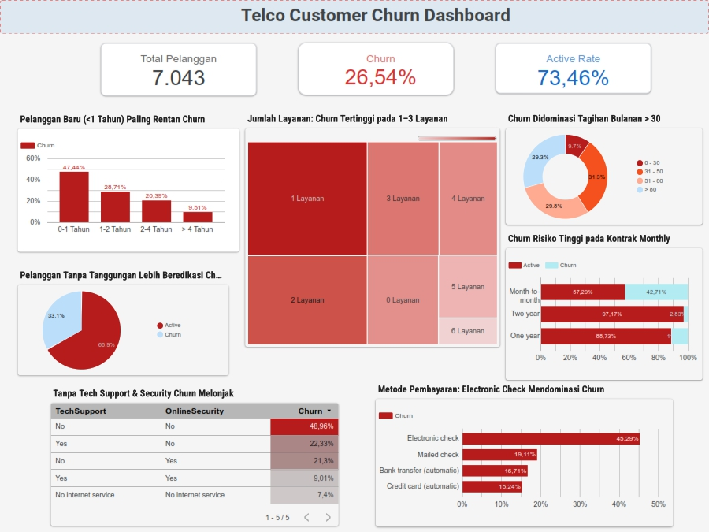

# Telco Customer Churn Analysis & Dashboard: Analisis Pembatalan Langganan Telekomunikasi

## 📌 Pemahaman Bisnis (Business Understanding)
Pada proyek ini, digunakan dataset **Telco Customer Churn** yang bertujuan untuk:
1. Menentukan faktor-faktor utama yang menjadi alasan berhentinya *customer* menjadi pelanggan (*churn*).
2. Merumuskan upaya atau strategi pencegahan (*retention strategy*) yang tepat untuk menekan angka pembatalan langganan layanan telekomunikasi.

Berdasarkan dataset pembersihan sebanyak **7.043 data pelanggan**, proyek ini mencakup proses *Data Cleaning*, *Exploratory Data Analysis (EDA)* menggunakan Python, serta pembuatan *Dashboard* interaktif di Looker Studio untuk mendukung pengambilan keputusan bisnis.

---

## Sebelum menganalisis data, dirumuskan tebakan awal (hipotesis) mengenai faktor-faktor yang mempengaruhi *churn* berdasarkan variabel bebas (*independent*) dan terikat (*dependent*):

| No | Fokus Analisis | Variabel Bebas (Independent) | Variabel Terikat (Dependent) | Pernyataan Hipotesis |
| :---: | :--- | :--- | :--- | :--- |
| **1** | **Jenis Kontrak** | `Contract` | `Churn` | Pelanggan dengan kontrak *Month-to-month* memiliki rasio *churn* lebih tinggi dibanding kontrak 1/2 tahun karena rendahnya *switching cost*. |
| **2** | **Masa Berlangganan** | `tenure` | `Churn` | Tingkat *churn* berbanding terbalik dengan lama berlangganan, di mana angka pembatalan tertinggi berada pada pengguna baru (*tenure* < 12 bulan). |
| **3** | **Bantuan Teknis** | `TechSupport`, `OnlineSecurity` | `Churn` | Pelanggan tanpa *TechSupport* atau *OnlineSecurity* memiliki tingkat *churn* lebih tinggi saat menghadapi kendala jaringan. |
| **4** | **Jumlah Layanan** | `Total_Services_Used` (Feature) | `Churn` | Semakin banyak akumulasi layanan yang digunakan, semakin rendah risiko pelanggan untuk *churn* karena tingginya ikatan produk. |
| **5** | **Beban Tagihan** | `MonthlyCharges` | `Churn` | Pelanggan dengan tagihan bulanan yang tinggi memiliki kecenderungan *churn* lebih besar akibat sensitivitas terhadap harga. |
| **6** | **Metode Pembayaran** | `PaymentMethod` | `Churn` | Pelanggan dengan metode pembayaran manual (*Mailed check*, *Electronic check*) memiliki *churn rate* lebih tinggi dibanding otomatis. |
| **7** | **Profil Tanggungan** | `Dependents` | `Churn` | Pelanggan dengan tanggungan keluarga (*Dependents = Yes*) memiliki risiko *churn* lebih tinggi karena fleksibilitas pengeluaran yang lebih besar. |

---

## Identifikasi Data & Kolom (Data Requirement)
Berdasarkan formulasi hipotesis di atas, diidentifikasi kebutuhan kolom/variabel data dari dataset 7.043 pelanggan:
* **Target Variable:** `Churn` (Yes / No).
* **Demografis & Layanan:** `Dependents`, `tenure`, `Contract`, `Total_Services_Used`, `TechSupport`, `OnlineSecurity`.
* **Keuangan & Pembayaran:** `MonthlyCharges`, `PaymentMethod`.

---

## Pembersihan Data (Data Cleaning)
Proses pembersihan dan manipulasi data dilakukan menggunakan Python dengan pustaka utama **`pandas`** dan **`numpy`**:
* **Libraries:** `import pandas as pd`, `import numpy as np`
* Penanganan nilai kosong (*missing values*)tabel `TotalCharges` pada  dan penyesuaian tipe data pada `MonthlyCharges`.
* Kategori/bining variabel numerik pada tabel `Partner`, `Dependents`, `PhoneService`, `PaperlessBilling`, `Churn` serta *feature engineering* pembuatan kolom (`Total_Services_Used`).
* Penyimpanan dataset bersih ke file `Telco_Customer_Churn_Cleaned.csv`.

---

## Analisis Hubungan & Pembuktian Hipotesis (Exploratory Data Analysis)
Eksplorasi data (EDA) dilakukan menggunakan skrip Python pada Jupyter Notebook untuk menemukan pola, tren, dan anomali untuk membuktikan 7 hipotesis yang awal. Visualisasi eksplorasi dibuat menggunakan library **`matplotlib`** dan **`seaborn`**:
* **Libraries:** `import pandas as pd`, `import numpy as np`, `import matplotlib.pyplot as plt`, `import seaborn as sns`
* **Hasil Pembuktian 7 Hipotesis Berdasarkan Grafik Python & Dashboard:**
  1. **H1 (Jenis Kontrak - Terbukti):** Pelanggan dengan kontrak *Month-to-month* mendominasi angka *churn* tertinggi sebesar **42.7%**, jauh melampaui kontrak *One year* (11.3%) dan *Two year* (2.8%).
  2. **H2 (Masa Berlangganan - Terbukti):** Berdasarkan kurva densitas *tenure*, puncak pembatalan tertinggi terkonsentrasi sangat tajam pada kelompok pengguna baru (*tenure* < 12 bulan / 0–1 tahun mencapai **47.44%**) dan terus menurun seiring lamanya berlangganan.
  3. **H3 (Bantuan Teknis - Terbukti):** Pelanggan tanpa layanan *TechSupport* maupun *OnlineSecurity* (`No`) memiliki *churn rate* tertinggi yang melonjak signifikan masing-masing hingga **41.6%** dan **41.8%** (bahkan mencapai **48.96%** jika kedua layanan tidak dimiliki).
  4. **H4 (Jumlah Layanan - Terbukti):** *Churn rate* tertinggi terjadi pada pengguna yang hanya menggunakan **1 layanan** (sebesar **45.8%**) dan berangsur turun secara konsisten seiring bertambahnya jumlah akumulasi layanan.
  5. **H5 (Beban Tagihan - Terbukti):** Berdasarkan distribusi *MonthlyCharges*, kurva *churn* melonjak signifikan pada kisaran tagihan bulanan menengah-tinggi yaitu antara **$75 hingga $100+**.
  6. **H6 (Metode Pembayaran - Terbukti):** Metode pembayaran manual seperti *Electronic check* mendominasi tingkat pembatalan tertinggi sebesar **45.3%**, jauh dibandingkan metode otomatis (*Bank transfer* / *Credit card*).
  7. **H7 (Profil Tanggungan - Tidak Terbukti / Insight Baru):** Hipotesis awal menduga pelanggan dengan tanggungan (`Dependents = Yes`) memiliki *churn* lebih tinggi karena fleksibilitas pengeluaran. Namun, **data mematahkan hipotesis ini**: pelanggan *tanpa* tanggungan (`Dependents = No / 0`) justru memiliki risiko *churn* jauh lebih tinggi, yaitu **31.3%** (mendominasi **66.9%** dari total keseluruhan pelanggan yang *churn*), karena mereka lebih mudah dan fleksibel untuk beralih atau membatalkan layanan tanpa memikirkan beban keluarga.

---

## Dashboard Visualisasi
Hasil analisis secara *Dashboard* menggunakan Looker Studio:

> 
> 
> 🔗 **[Klik di sini untuk mengakses Interactive Dashboard di Looker Studio](https://datastudio.google.com/reporting/4a48e395-edd0-424e-a7ba-4a07a026b3b7)**

---

## Kesimpulan & Rekomendasi Bisnis

### 📌 Kesimpulan
Berdasarkan pembuktian 7 hipotesis melalui analisis Python dan *dashboard*, faktor utama yang memicu pembatalan langganan (*churn*) adalah:
1. **Fleksibilitas & Transisi Rentan:** Tingginya *churn* pada kontrak *Month-to-month* (**42.7%**) dan pelanggan baru dengan masa berlangganan < 1 tahun (**47.44%**).
2. **Minimnya Keterikatan Produk (Layanan & Fitur):** Pengguna yang hanya menggunakan 1 layanan (**45.8%**) serta pelanggan tanpa fitur keamanan/bantuan teknis (*TechSupport/OnlineSecurity* hingga **48.96%**) memiliki risiko pembatalan tertinggi.
3. **Sensitivitas Harga & Metode Pembayaran:** Tagihan bulanan tinggi (**$75–$100+**) dan penggunaan metode pembayaran manual seperti *Electronic check* (**45.3%**) menjadi indikator kuat terjadinya *churn*.
4. **Profil Demografi (*Insight* Baru):** Pelanggan tanpa tanggungan keluarga (`Dependents = No`) mendominasi total *churn* (**66.9%** dari total *churn*), menunjukkan kelompok ini jauh lebih fleksibel untuk beralih ke kompetitor.

    ### 💡 Upaya Pencegahan (Rekomendasi Strategis)
    1. **Inisiatif *Onboarding* & Diskon Kontrak Jangka Panjang (Menjawab H1 & H2):** 
    Fokuskan program retensi pada 12 bulan pertama dengan memberikan insentif/diskon khusus agar pengguna *Month-to-month* bersedia beralih ke kontrak 1 atau 2 tahun.
    2. **Strategi *Product Cross-Selling* & *Free Trial Bundling* (Menjawab H3 & H4):**
    * Dorong pengguna single-service (1 layanan) untuk mengambil paket *cross-selling* guna meningkatkan keterikatan produk (*product stickiness*).
    * Wajibkan penawaran *free trial* fitur *TechSupport* dan *OnlineSecurity* di awal masa berlangganan untuk mengurangi kecenderungan pembatalan.
    3. **Insentif Pembayaran Otomatis / Auto-Pay Campaign (Menjawab H5 & H6):**
    Berikan potongan tagihan mikro (misal: diskon $2–$5/bulan) bagi pengguna *Electronic Check* / *Mailed Check* yang bersedia beralih ke sistem pembayaran otomatis (*Bank Transfer* / *Credit Card*) untuk menekan dampak sensitivitas harga.
    4. **Strategi Kampanye Spesifik Profil *Single / No Dependents* (Menjawab H7 - *Insight* Baru):**
    Rancang kampanye retensi dan program loyalitas berbasis personalisasi (misal: penawaran fleksibilitas kecepatan internet atau paket hiburan solo) yang menargetkan pelanggan tanpa tanggungan keluarga untuk menjaga keterikatan mereka.

# Tools & Technologies Used
* **Dataset Source**: Kaggle (Telco Customer Churn)
* **Workspace & Data Processing**: Google Colab (Python: pandas, numpy ,matplotlib, seaborn)
* **Data Inspection & Preparation**: Google Sheets / Microsoft Excel
* **Interactive Dashboard**: Looker Studio
* **Version Control & Documentation**: GitHub

